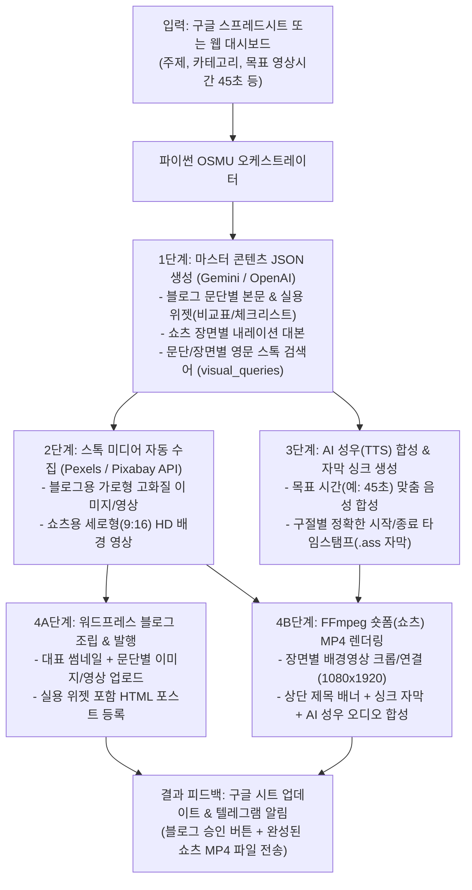

# [확장 확정 계획서] 구글 시트 기반 워드프레스 블로그 & 숏폼(쇼츠) 올인원 자동 제작 시스템 (OSMU Engine)

## 1. Goal Description (목표 및 비전)

기존 계획이었던 **"구글 시트 주제 입력 ➡️ 워드프레스 고품질 자동 발행"**에 더해, 두 번째 레퍼런스처럼 **"지정한 무료 영상/이미지 플랫폼(Pexels, Pixabay API)에서 문단별 주제에 어울리는 영상·이미지를 자동 수집하여 블로그 문단마다 삽입하고, 동시에 AI 대본 + AI 성우(TTS) + 자동 자막 싱크 + 배경영상을 결합해 원하는 시간(30~60초)짜리 숏폼(유튜브 쇼츠/릴스) 영상을 자동 렌더링"**하는 **OSMU(One-Source Multi-Use) 통합 미디어 엔진**을 구축합니다.

---

## 2. 핵심 추가 및 개선 기능 (New Killer Features)

### 🎬 1) 문단별 맞춤 영상·이미지 자동 수집 및 삽입 (Pexels & Pixabay API)
- LLM이 주제를 4~6개 문단(Scene/Section)으로 나누고, 각 문단의 핵심 내용을 **'촬영 가능한 영문 시각 키워드'**(예: `tinnitus ear pain`, `medical consultation`)로 자동 변환합니다.
- **블로그 본문**: 각 소제목 문단마다 어울리는 고화질 스톡 이미지 또는 짧은 루프 영상을 워드프레스 미디어 라이브러리에 업로드하고 본문 중간중간에 자동 배치합니다.
- **숏폼 배경**: 각 대본 구간마다 어울리는 세로형(9:16, `1080x1920`) 고화질 배경 영상을 자동으로 다운로드하여 장면 전환을 구성합니다.

### 🎙️ 2) 원하는 길이(30~60초) 맞춤 대본 + AI 성우(TTS) + 정밀 자막 싱크
- **목표 시간 제어**: 구글 시트(또는 웹 UI)에서 원하는 영상 시간(예: `30초`, `45초`, `60초`)을 지정하면, 한국어 발화 속도(초당 약 4.5~5음절)에 맞춰 대본 분량을 자동 설계하고 실제 합성된 TTS 길이를 측정해 정밀 보정합니다.
- **멀티 TTS 엔진**:
  - **Edge-TTS (기본 내장)**: 별도 유료 과금 없이도 자연스러운 한국어 남/여 성우(`SunHi`, `InJoon`) 음성과 **단어/구절 단위 정확한 자막 타임스탬프(WordBoundary)**를 즉시 추출합니다.
  - **OpenAI TTS / Google Cloud TTS / ElevenLabs**: 설정에서 API 키 입력 시 프리미엄 성우로 언제든 전환 가능.
- **다이나믹 자막 번인(Burn-in)**: 음성 타임스탬프에 100% 싱크된 한글 자막(ASS 포맷, 가독성 높은 굵은 폰트 + 외곽선 + 상단 고정 제목 배너)을 영상에 자동 합성합니다.

### 📱 3) 4단계 실시간 렌더링 파이프라인 & 텔레그램/웹 UI 연동
직관적인 4단계 프로세스를 구현합니다:
- `▶ 1단계: 공통 마스터 기획안(블로그 본문 + 쇼츠 대본) 생성 중...`
- `▶ 2단계: AI 성우 음성(TTS) 및 자막 타임스탬프 생성 중...`
- `▶ 3단계: 문단별/장면별 무료 배경 영상·이미지 자동 다운로드 중... (Pexels/Pixabay)`
- `▶ 4단계: 워드프레스 조립 및 FFmpeg 숏폼 영상 렌더링 중...`
- 완료 시 **구글 시트에 블로그 URL과 쇼츠 파일 경로 기록** + **텔레그램으로 블로그 미리보기 및 렌더링된 MP4 쇼츠 영상을 직접 전송**하여 스마트폰에서 바로 유튜브/릴스에 올릴 수 있게 합니다.

---

## 3. 전체 시스템 아키텍처 (OSMU Pipeline)



---

## 4. 스프레드시트 확장 열(Column) 구성

| 열 | 컬럼명 | 설명 및 예시 |
|:---:|:---:|:---|
| **A** | **주제/키워드** | `이명난청과 TMS치료`, `마운자로 처방 기준` |
| **B** | **작업모드** | `블로그+쇼츠(올인원)`, `블로그만`, `쇼츠만` |
| **C** | **목표시간(초)** | `45` (기본 45초, 30~60초 선택 가능) |
| **D** | **진행상태** | `대기`, `1단계:대본생성`, `2단계:음성합성`, `3단계:영상수집`, `4단계:렌더링`, `승인대기`, `발행완료` |
| **E** | **생성된 제목** | AI가 생성한 블로그/쇼츠 제목 |
| **F** | **생성된 본문/대본** | 블로그 HTML 및 쇼츠 내레이션 대본 요약 |
| **G** | **포스트 URL** | 워드프레스 게시글 링크 |
| **H** | **쇼츠 영상 URL** | 렌더링 완료된 MP4 다운로드/미리보기 링크 |
| **I** | **작업일시** | `2026-10-28 14:10` |

---

## 5. 구현 파일 구조

```
/home/ubuntu/auto-word-press/
├── README.md                      # 전체 설치, API 키(Pexels/Pixabay/WP/AI) 발급 및 사용 가이드
├── PROJECT.md                     # 프로젝트 구조 및 운영 문서
├── AGENTS.md                      # 에이전트 역할 정의
├── HANDOFF.md                     # 작업 히스토리 및 인계 문서
├── PLAN.md                        # 상세 기획 및 구현 명세서 (본 파일)
├── requirements.txt               # python 의존성 (gspread, requests, google-genai, openai, edge-tts, pillow 등)
├── .env.example                   # 환경변수 템플릿
├── assets/
│   └── fonts/                     # 자막 렌더링용 한글 폰트 (NotoSansKR / NanumGothic 등)
├── gas/
│   └── Code.gs                    # 구글 시트 상단 메뉴 ('🤖 자동발행 봇') 스크립트
├── templates/
│   └── prompt_template.py         # 블로그 HTML 위젯 + 쇼츠 장면별 대본/검색어 통합 프롬프트
└── src/
    ├── __init__.py
    ├── config.py                  # 환경변수 및 설정 관리
    ├── db.py                      # SQLite 기반 작업 상태/체크포인트 관리 (중복 발행 방지)
    ├── sheet_manager.py           # 구글 시트 실시간 입출력 연동
    ├── ai_generator.py            # 마스터 콘텐츠 JSON 생성 (문단별 본문 + 쇼츠 대본 + 시각 키워드)
    ├── stock_media.py             # Pexels & Pixabay API 연동 (문단별 이미지 & 배경 영상 다운로드)
    ├── tts_engine.py              # AI 성우 음성 합성 및 자막 타임스탬프(.ass) 생성기
    ├── video_renderer.py          # FFmpeg 기반 1080x1920 쇼츠 영상 합성기 (배경+자막+성우+배너)
    ├── wp_client.py               # 워드프레스 REST API (문단별 미디어 업로드 & 포스트 발행)
    ├── telegram_notifier.py       # 텔레그램 블로그 미리보기 카드 + 쇼츠 MP4 파일 전송 및 원클릭 승인
    ├── web_ui.py                  # 직관적인 웹 컨트롤러 & 실시간 로그창 (사진 2 UI 재현)
    └── orchestrator.py            # 전체 파이프라인 실행 엔진
```

---

## 6. Confirmed User Choices (최종 확정 선택 사항)

- **실행 및 제어 인터페이스**: **구글 스프레드시트 + 웹 컨트롤 대시보드(실시간 1~4단계 콘솔창) 동시 제공**
  - 구글 시트에서 대량/자동화 입력 가능 + 모바일/PC 웹 브라우저에서 직관적인 UI(제목 입력, 주제 체크박스, 목표 시간 설정, 실시간 초록색 터미널 로그 및 프로그레스 바)로 원클릭 제작 가능
- **미디어 수집 & AI 성우(TTS) 구성**: **Pexels·Pixabay 무료 스톡 API + AI 이미지 생성 하이브리드 & 한국어 무료 고품질 성우(Edge-TTS) 기본 탑재**
  - 문단별 주제에 맞는 배경 영상/이미지를 Pexels·Pixabay에서 우선 수집하고, 필요 시 AI 이미지(Gemini/OpenAI)로 보완
  - 한국어 성우 음성과 정밀 자막 타임스탬프(.ass) 자동 합성 (OpenAI/Google/ElevenLabs 유료 성우로도 언제든 설정 전환 가능)

---

## 7. Verification Plan (검증 계획)

### Automated Tests
1. **마스터 콘텐츠 생성 테스트**: 주제 입력 시 문단별 블로그 HTML + 목표 시간(예: 45초)에 맞는 쇼츠 대본 + 영문 스톡 검색어가 정확한 JSON 스키마로 생성되는지 검증.
2. **TTS & 자막 싱크 테스트**: 한국어 대본을 TTS로 합성하여 오디오 파일(`.mp3`/`.wav`)과 싱크가 맞는 `.ass` 자막 파일이 정상 생성되는지 검증.
3. **스톡 미디어 & FFmpeg 렌더링 테스트**: 배경 영상(또는 폴백 다이나믹 배경) + 성우 음성 + 한글 자막을 합성하여 실제 재생 가능한 `1080x1920` `.mp4` 쇼츠 파일이 정상 렌더링되는지 검증 (`ffprobe`로 해상도/오디오/길이 확인).
4. **웹 대시보드 & 워드프레스/텔레그램 연동 테스트**: 웹 UI에서 실시간 1~4단계 진행률 표시 및 워드프레스 초안 생성·텔레그램 알림 발송 검증.
